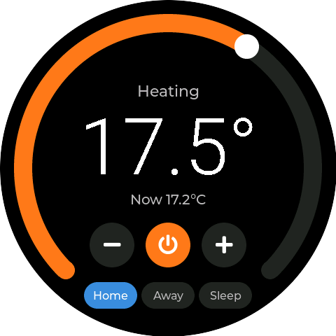
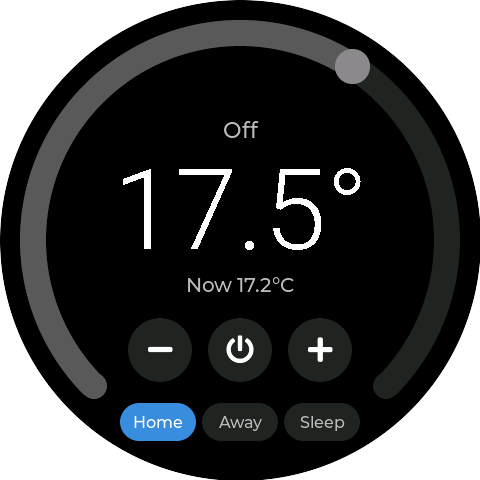

# ESPHome Round Display

ESPHome configuration for the LilyGo T-RGB 2.1" round (full circle) display, with an LVGL thermostat interface
that controls a Home Assistant climate entity.

| Heating                                              | Off                                          |
| ---------------------------------------------------- | -------------------------------------------- |
|  |  |

| Part             | ESPHome component                                                          |
| ---------------- | -------------------------------------------------------------------------- |
| ST7701S panel    | [`mipi_rgb`](https://esphome.io/components/display/mipi_rgb/), `T-RGB-2.1` |
| CST820 touch     | [`cst816`](https://esphome.io/components/touchscreen/cst816/)              |
| XL9535 expander  | [`xl9535`](https://esphome.io/components/xl9535/)                          |
| UI               | [`lvgl`](https://esphome.io/components/lvgl/)                              |

## Usage

1. Use ESPHome 2026.11.0b1 or newer. Until 2026.11.0 is released, that means the ESPHome Device Builder beta in
   Home Assistant. The updated `xl9535` driver below does not load on 2026.10.
2. Copy `secrets.yaml.example` to `secrets.yaml` and fill in your values.
3. Set `climate_entity` under `substitutions` to your thermostat's entity ID.
4. Build and flash over USB:

   ```bash
   esphome run lilygo-t-rgb-2-1.yaml
   ```

5. Add the device in Home Assistant. In the ESPHome integration, click **Configure** next to the device and turn on
   **Allow the device to perform Home Assistant actions**. Without it the screen shows the thermostat's state but
   cannot change it.

## Thermostat Interface

- The outer ring sets the target temperature in 0.5 °C steps. The − and + buttons do the same. A change is sent to
  Home Assistant one second after the last touch, as a `climate.set_temperature` action.
- The ring is orange while the thermostat is heating, blue when idle and grey when off.
- The power button switches the thermostat between `heat` and `off`.
- The Home, Away and Sleep buttons set the preset mode. The active preset is highlighted.
- The backlight dims to 15% after 60 seconds without a touch, and comes back on at the next touch.
- The range of the ring (10 to 22 °C) and the preset names match `climate.household_thermostat`. Change
  `min_value`, `max_value`, the `std::clamp` limits in `step_target` and the preset buttons for another thermostat.

## Notes

- The `xl9535` driver is pulled from the branch of [mreditor97/esphome PR #1](https://github.com/mreditor97/esphome/pull/1)
  with `external_components`. That version caches the output registers, so each pin write is one I2C transfer. Change
  the `ref` to a tag once a release includes it, or remove the block once it is in ESPHome.

- The panel's SPI init lines, reset, power enable and touch reset are all on the XL9535 expander. The init
  sequence is bit-banged over I2C at boot, so the display takes a moment to come up.
- GPIO46 drives the backlight as a dimmable light, exposed to Home Assistant as `Backlight`.
- If touches land in the wrong place, add a `transform` (`mirror_x`, `mirror_y`, `swap_xy`) to the touchscreen.
